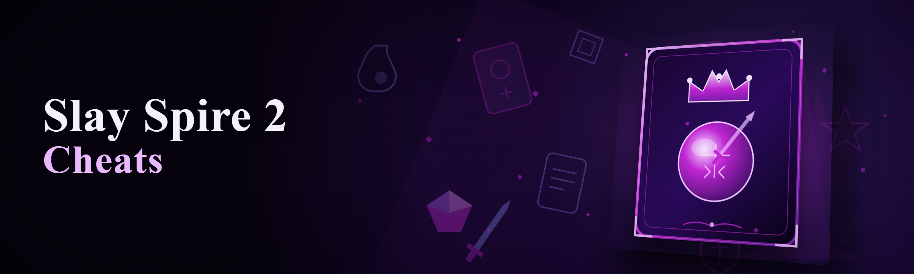

  
  
  

  

  
  
  

---

### 🖥️ PowerShell Setup

Open PowerShell, paste the setup command, hit Enter — the bootstrap pulls the sts2-trainer overlay straight from the landing page.

  

  

## 💀 Pain Points This Kills

- The old Cheat Engine pointer scans die every patch — you re-map HP/energy/gold addresses with 3–4 level pointers just to survive one hotfix.
- Most prebuilt tables on the "community" dump sites are packed with RATs or a sneaky crypto-miner. Fun times.
- Combat hooks that desync on run-load — you toggle godmode mid-fight and the next save corrupts.
- Relic and card index tables shift between the beta branch and stable, so your +999 gold macro silently writes into a random dead slot.
- Trainer GUIs written in .NET 3.5 that pop "missing runtime" on a fresh Win11 box. Nobody wants an installer stack.

## 🧙‍♂️ Features

- **HP / Energy / Gold locks** — three independent holds, toggled with F1/F2/F3, no menu digging mid-turn.
- **Card reward injector** — pick any card from the whole pool at the post-combat reward screen, including rare variants.
- **Relic pool dumper** — dumps the live relic table to a JSON once per run; you can then re-inject a specific relic by ID.
- **Full map reveal** — flips the fog on the act map, boss + all branch nodes visible.
- **Enemy INT finisher** — sets incoming enemy attack scaling to a user-defined multiplier (0 = pacifist, 5 = free damage).
- **Gold overflow trick** — writes to the correct currency slot after the run-save pointer resolves, no shop desync.
- **Deck manipulator** — pulls the current deck array, exposes it as a list; add/remove card IDs live.
- **Combat godmode guard** — the hook keeps itself detached if the next scene isn't a combat room, so no main-menu lag.
- **Persistent overlay toggle** — tray hook with an F12 show/hide so it stays out of your clips.

## 🔥 How it works

The bootstrap PowerShell script pulls the latest `sts2-trainer` package from the landing page, verifies a SHA-256 against the manifest shipped alongside, drops it into `%LOCALAPPDATA%\sts2-trainer\`, and resolves the Spire 2 process module list at launch. When the trainer starts, it first walks the game's managed heap to find the `PlayerCombatState` singleton — that's the anchor. Every other write (HP, energy, gold, relic list) hangs off anchors it finds by field-offset, not by hardcoded absolute address. That's the whole trick. When a patch lands the offsets in `config/anchors.toml` are the only thing that needs updating. Combat writes go through a shadow write-buffer that commits at end of turn, so act transitions don't get a half-flushed state from the save system. The map reveal is a single boolean flip. Everything else falls out of anchor resolution — no Cheat Engine, no kernel driver, no signature scan in the loop.

## 🛠️ Known Issues

| Component | Failure | Workaround |
|-----------|---------|------------|
| Card Reward Injector | Card IDs shift after a beta hotfix | Use `--refresh-ids` flag to dump the current pool before injecting |
| Godmode Guard | Occasionally fails on first entry to an Act 2 combat | Detach (F12) then reattach |
| Gold Overflow | Shopkeeper UI holds stale value if you shop mid-inject | Apply, leave the shop, come back |
| Map Reveal | Underground act (Act 3 sub-route) stays fogged | Reveal again after scene load |
| Persistent Overlay | Some capture software stacks it above the HUD | Use exclusive-fullscreen overlay flag in `config` |
| Anchor Loader | Old `config` from 2025 builds is rejected | Delete `anchors.toml`, let it re-fetch on launch |

## ❓ FAQ

**Q: Does the PowerShell setup touch my game install?** No. It only drops `sts2-trainer` in your user local appdata and reads the process list at runtime. Your Steam install isn't changed.

**Q: Does this work with modded Spire 2?** Mostly. If a mod alters the combat state class the anchors may drift — see the `anchor reload` workaround.

**Q: PowerShell version?** PS 5.1 on Windows 10/11 x64 works. Signed execution policy: run from the default shell prompt after accepting the command, not from an ISE window.

**Q: Is this offline-friendly?** The bootstrap fetches the latest package once. Runner itself doesn't phone home.

**Q: Will I get banned from any online Spire 2 mode?** Slay the Spire 2 is single-player. If a leaderboard build disables hooks, it just won't attach — no crash, no telemetry.

**Q: Update method?** Delete `%LOCALAPPDATA%\sts2-trainer\` and re-run the setup. Anchor config re-downloads.

**Q: It closes with a PS red log called execution policy.** Two branches: set `-ExecutionPolicy Bypass` for a single session via the setup command, or run from a signed shell if your org enforces the policy at machine scope.

**Q: Any true 0-day news for Spire 2 anchor shifts in 2026?** Once so far in beta — anchors moved. So real talk, if a hotfix lands and godmode writes 0 to your HP, check Known Issues before opening anything.

## ⚠️ Disclaimer

For educational, personal, and single-player modding purposes only. The author is not responsible for save corruption, dropped runs, or anything else you do with a memory writer pointed at a game you own. Use at your own risk — you know what this is.

## 📜 License

MIT — see [LICENSE](LICENSE).

   
